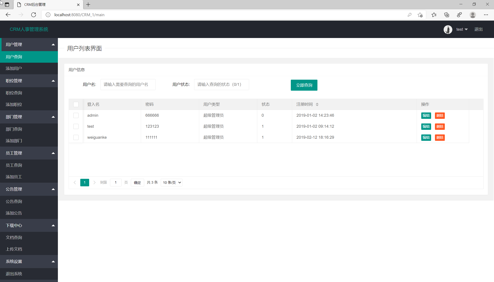
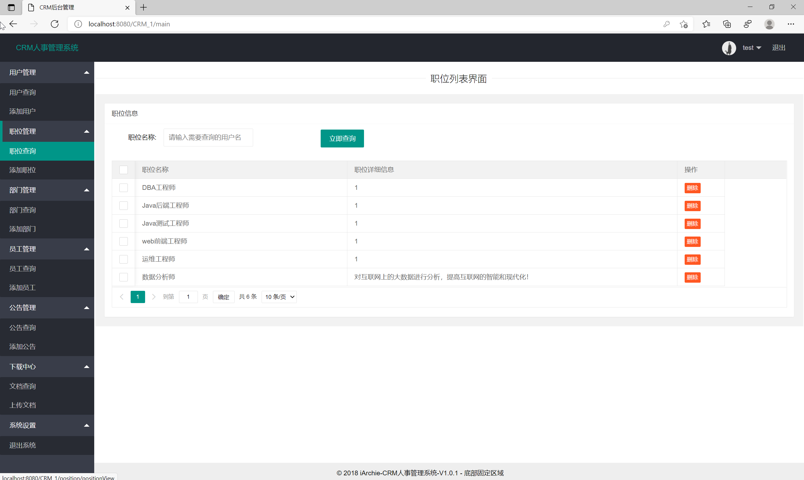
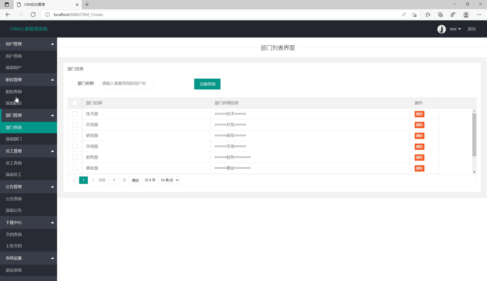
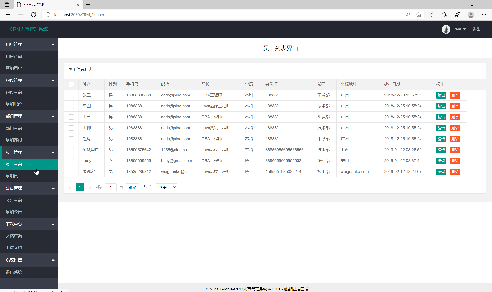
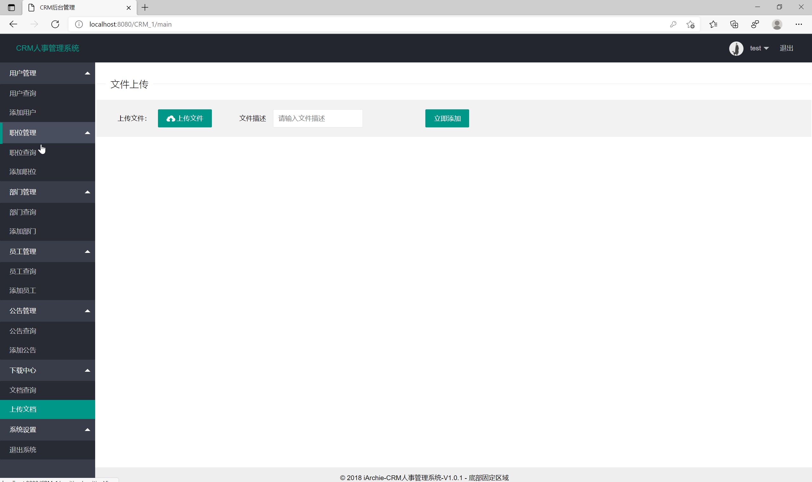
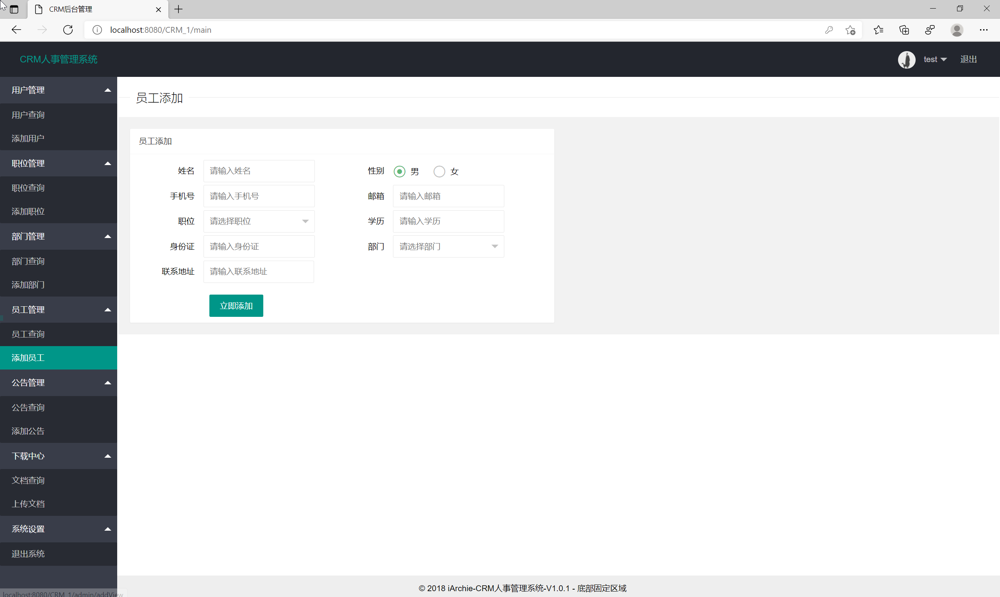

# -- 全局占位符：将 {SITE_URL} 替换为正式站点地址 -->（SSM）— 完整源码 + 数据库脚本 + 运行说明
# CRM人事管理系统_ssm+jsp

本商品为「CRM人事管理系统_ssm+jsp」，基于 SSM 技术栈开发。

## 👉 完整项目 / 演示录屏 / 更多项目：{SITE_URL}

## ✨ 功能清单

- 用户
- 用户添加
- 职位
- 职位添加
- 公告
- 公告添加修改
- 员工
- 员工添加
- 文件doc
- 上传文件
- department
- department添加

## 🛠 技术栈

- mybatis.version: 3.4.5
- spring-context: ${spring.version}
- spring-jdbc: ${spring.version}
- spring-webmvc: ${spring.version}
- spring-test: ${spring.version}
- mybatis: ${mybatis.version}
- mybatis-spring: 1.3.0
- pagehelper: 5.1.2
- mysql-connector-java: 5.1.38
- druid: 1.0.26
- aspectjweaver: 1.8.7
- fastjson: 1.2.47
- jackson-databind: 2.9.5
- junit: 4.12
- javax.servlet-api: 3.0.1
- jstl: 1.2

## 📁 目录结构

```
crm-ren-shi-guan-li-xi-tong-ssm-jsp-ssm/
├── db/
│   └── crmsys.sql
├── docs/
│   ├── DESENSITIZE.md
│   └── REVIEW.md
├── lib/
│   ├── aspectjweaver-1.8.7.jar
│   ├── druid-1.0.26.jar
│   ├── fastjson-1.2.47.jar
│   ├── hamcrest-core-1.3.jar
│   ├── jackson-annotations-2.9.0.jar
│   ├── jackson-core-2.9.5.jar
│   ├── jackson-databind-2.9.5.jar
│   ├── javax.servlet-api-3.0.1.jar
│   ├── jconsole.jar
│   ├── jsqlparser-1.0.jar
│   ├── jstl-1.2.jar
│   ├── junit-4.12.jar
│   ├── log4j-1.2.17.jar
│   ├── lombok-1.16.6.jar
│   ├── mybatis-3.4.5.jar
│   ├── mybatis-spring-1.3.0.jar
│   ├── mysql-connector-java-5.1.38.jar
│   ├── pagehelper-5.1.2.jar
│   ├── slf4j-api-1.7.21.jar
│   ├── slf4j-log4j12-1.7.21.jar
│   ├── spring-aop-5.0.2.RELEASE.jar
│   ├── spring-beans-5.0.2.RELEASE.jar
│   ├── spring-context-5.0.2.RELEASE.jar
│   ├── spring-core-5.0.2.RELEASE.jar
│   ├── spring-expression-5.0.2.RELEASE.jar
│   ├── spring-jcl-5.0.2.RELEASE.jar
│   ├── spring-jdbc-5.0.2.RELEASE.jar
│   ├── spring-test-5.0.2.RELEASE.jar
│   ├── spring-tx-5.0.2.RELEASE.jar
│   ├── spring-web-5.0.2.RELEASE.jar
│   └── spring-webmvc-5.0.2.RELEASE.jar
├── src/
│   └── main/
├── 运行截图/
│   ├── 2022-12-23_16-19-29.png
│   ├── 2022-12-23_16-24-12.png
│   ├── 2022-12-23_16-24-19.png
│   ├── 2022-12-23_16-24-25.png
│   ├── 2022-12-23_16-24-31.png
│   ├── 2022-12-23_16-24-45.png
│   └── 2022-12-23_16-25-00.png
├── pom.xml
└── 运行必读.txt
```

## 🚀 快速开始

### 环境要求
- JDK 1.8+（以 `pom.xml` 为准）
- Maven 3.x
- MySQL 5.7+ / 8.x

### 步骤
1. 克隆本仓库
2. 用 IDE 打开项目根目录（含 `pom.xml` / `package.json`）
3. 导入 `db/` 或根目录下的 `*.sql` 到 MySQL
4. 修改 `src/main/resources/application.yml`（或 `.properties`）中的数据库账号密码
5. 启动主启动类（`*Application.java`）或执行 `mvn spring-boot:run`
6. 浏览器访问 `http://localhost:8080`

### 端口
- `8080`

### 账号
- 系统账号信息
- 账号：test
- 密码：123123

## 📸 截图









## ❓ 常见问题

**跑不起来？**
- 确认 JDK / Maven / MySQL 版本与运行必读一致；先能编译通过再启动。

**端口占用？**
- 修改 `server.port`，或关闭占用 8080 的进程。

**数据库连接失败？**
- 检查库名是否已创建、账号密码、时区与 `allowPublicKeyRetrieval` 等 JDBC 参数。

## 📚 更多开源项目

完整清单见仓库内 [`PROJECTS.md`](./PROJECTS.md)。

## 免责声明与许可

- 本仓库仅供学习交流，不包含商业授权。
- 源码来源于教学/毕设实践整理，使用风险自负。
- 转载请注明出处；请勿用于非法用途。
- 详见 [`LICENSE`](./LICENSE)。

---

**更多完整项目 → {SITE_URL}**